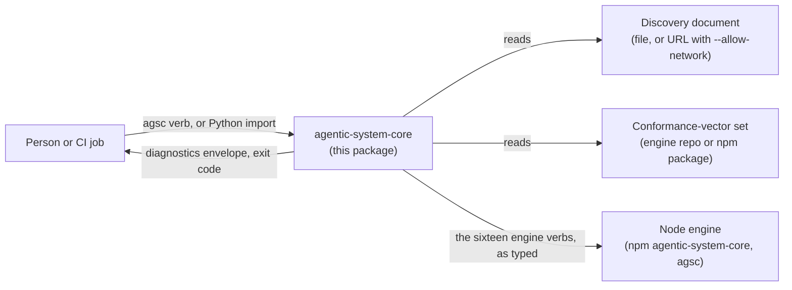
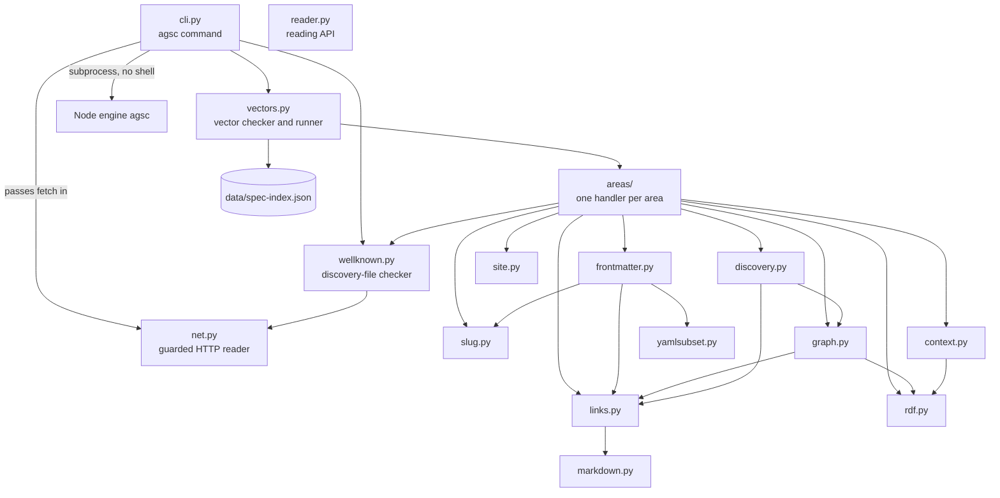
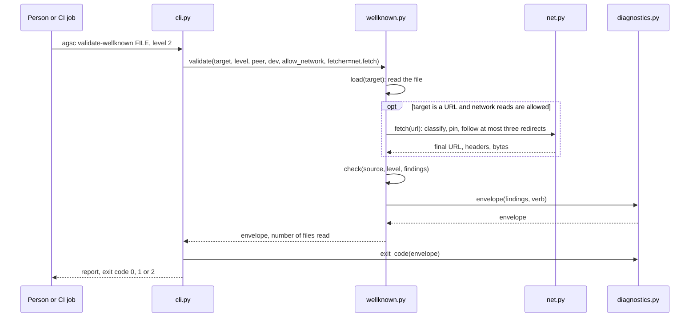

# Architecture of the Python package

**Summary.** What the package talks to, and how its modules call each other. The
diagrams use the module names of `src/agentic_system_core/`; the one-line purpose of each
module is in [src/agentic_system_core/README.md](../src/agentic_system_core/README.md).

**Read after:** the [README](../README.md). **Read next:** [MAINTAINING.md](MAINTAINING.md).

## The package and its surroundings

The package reads a discovery document and a vector set, writes a diagnostics envelope
and an exit code, and hands every verb it does not run itself to the Node engine. It opens
a network connection only when `--allow-network` is on the command line.

The engine is a separate program: the package never imports it. The tests run it beside
this repository to prove the two agree (see [MAINTAINING.md](MAINTAINING.md)).

## Modules and calls

An arrow means "imports". `cli.py` is the only entry point; the rest is a library.
`jcs.py`, `diagnostics.py` and `urls.py` are used from several places and are left out of
the picture to keep it readable: `jcs.py` (canonical JSON) is imported by many
modules, `diagnostics.py` (the envelope and the exit code) by `cli.py`, `wellknown.py`
and `vectors.py`, and `urls.py` by `net.py`, `reader.py` and `wellknown.py`.

`reader.py` stands apart: no other module imports it, and it imports only the package
constants, `urls.py` and `jcs.py`. It never opens a connection; a fetcher is passed in by
the caller.

## One run of `agsc validate-wellknown`

