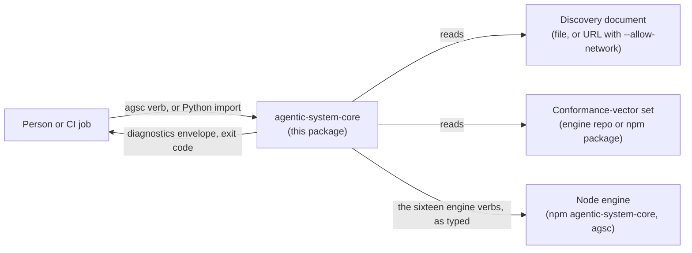
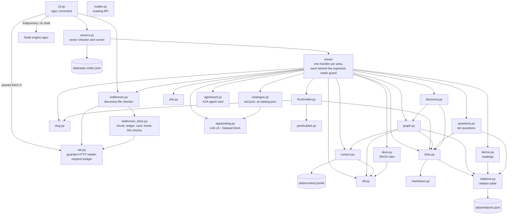
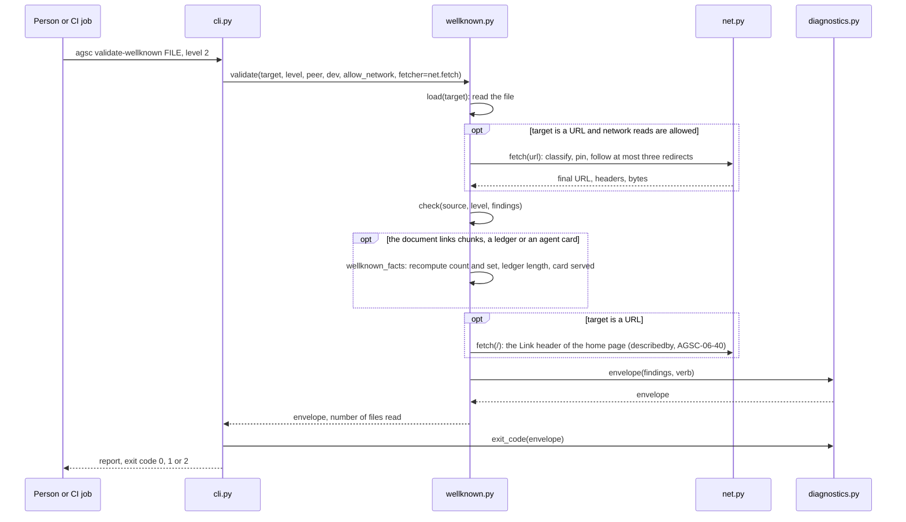

# Architecture of the Python package

**Summary.** What the package talks to, and how its modules call each other. The
diagrams use the module names of `src/agentic_system_core/`; the one-line purpose of each
module is in [src/agentic_system_core/README.md](../src/agentic_system_core/README.md).

**Read after:** the [README](../README.md). **Read next:** [MAINTAINING.md](MAINTAINING.md).

## The package and its surroundings

The package reads a discovery document and a vector set, writes a diagnostics envelope
and an exit code, and hands every verb it does not run itself to the Node engine. It opens
a network connection only when `--allow-network` is on the command line.

The engine is a separate program: the package never imports it. The tests run it beside
this repository to prove the two agree (see [MAINTAINING.md](MAINTAINING.md)).

## Modules and calls

An arrow means "imports". `cli.py` is the only entry point; the rest is a library.
`jcs.py`, `diagnostics.py` and `urls.py` are used from several places and are left out of
the picture to keep it readable: `jcs.py` (canonical JSON) is imported by many
modules, `diagnostics.py` (the envelope and the exit code) by `cli.py`, `wellknown.py`
and `vectors.py`, and `urls.py` by `net.py`, `reader.py` and `wellknown.py`.

The relation table of AGSC-03-01 has one source in the package: `relations.py` reads
`data/relations.json`, the engine's table written out by Node, and every module that
needs a key, an inverse or a property takes it from there (`tests/test_architecture.py`
fails when a module spells out a computed inverse name).

`areas/build_tree.py` checks the files a whole build wrote against the `build` cases
that need one (`build-0020` to `build-0028`, less `build-0024`, withdrawn in 1.1). It
builds nothing: the caller passes a function that runs a build, and the test suite
passes one that runs the engine's.

Every area handler runs behind `areas/_expected_reads.py`, the twin of the engine's
guard: a pass that left a member of a case's `expected` unread is turned into a fail,
so a vector cannot pass on an expectation no code compared.

`net.py` is the only module that opens a connection (`tests/test_architecture.py`
fails otherwise): every request of a run passes its address classification, its caps,
its deadline and one request budget for the run, redirects included (AGSC-11-10(c)).
`signposting.py`, `catalogue.py` and `agentcard.py` are pure writers of data: they give
what the home page, the two catalogue files and the agent card carry, so the vectors
that pin those bytes run here, though this package writes no site.

`reader.py` stands apart: no other module imports it, and it imports only the package
constants, `urls.py` and `jcs.py`. It never opens a connection; a fetcher is passed in by
the caller.

## One run of `agsc validate-wellknown`

